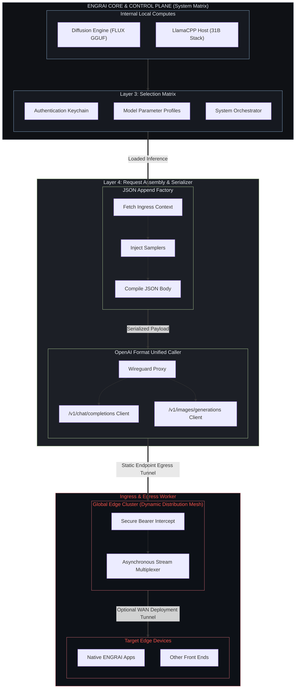

# Architecture

ENGRAI SERVER is the trusted host daemon between client devices and local compute. The product owns the stable contract; numerical engines are replaceable providers below it.
## Layers
This diagram is a product-direction sketch. The current implementation is a single gateway with local worker processes and an initial [SymLink paired application channel](SYMLINK.md). The depicted global edge-distribution layer remains planned. Network tunnels are operator-managed infrastructure, not provisioned by the gateway. Installation does not require those planned layers.

WireGuard is transport infrastructure, not the application protocol. SymLink v1 runs over an existing WebSocket-capable path and provides key-based device pairing, encrypted sessions, text-model listing and streaming chat. Broader capability negotiation, state/event subscriptions and transfers remain planned. Upstream engine APIs are never reachable by client devices.

## Sources of Truth
| Manifest | Source |
| --- | --- |
| Portable model identity | `@models/catalog/*.json` |
| Model-manifest contract | `@models/schemas/model-manifest.schema.json` |
| One host's deployment choices | XDG config `engrai-server/deployments/` |
| Engine capability and argument mapping | `src/engrai_server/engines/` |
| API and orchestration | `src/engrai_server/` |
| Presentation source | `ui/` |
| Card Studio (API, library, browser app) | `src/engrai_server/cardgen/` |
| Ledger (entries, index, recall, embedding worker) | `src/engrai_server/ledger/` |
| Shipped presentation | `src/engrai_server/static/` |

The repository never treats an executable command as model identity. A model manifest resolves to verified local artifacts, combines them with a local typed deployment, and an engine adapter compiles them into a launch specification.

## Runtime invariants
1. ENGRAI is the only client-reachable host service.
2. Engine workers bind only to loopback or private IPC.
3. ENGRAI owns worker process groups and terminates only those it created.
4. Model switching and generation are serialized where an engine requires it.
5. Portable manifests contain no absolute paths, secrets, or device topology.
6. Host tuning lives in ignored XDG configuration.
7. The UI edits typed domain values; raw provider flags are an advanced compatibility escape hatch, never the canonical record.
8. Runtime updates are explicit, pinned, checksummed, and never replace an executable serving an active request.
9. A clean clone is sufficient to reproduce the Python package and compiled UI.
10. A launch contains no unresolved placement choices: provider, devices, layer count, split, context, and cache policy are concrete before spawn.
11. Provider auto-fit is disabled. Failure is observable and repeatable rather than hidden behind an engine-selected reduction in context or offload.
12. Requested flags and effective model capabilities are different records. Architecture-specific limitations discovered at load are observable.

## Inference Engines
The text gateway launches the verified ENGRAI llama.cpp runtime through `LlamaCppControlPlane`. A route records a model file and prompt policy; its typed llama.cpp deployment is compiled into the launch. Routes are created in the web UI and are never seeded or packaged. The image lane launches the separately pinned stable-diffusion.cpp runtime (`engrai-image`); there is no third-party fallback engine.

## Chat Completions
`/v1/chat/completions` is rendered by the gateway, not by llama-server's chat handler (`src/engrai_server/engines/llamacpp/chat.py`). Roleplay clients send trailing assistant prefills, post-history `system` turns, and consecutive same-role messages. llama-server's handler rewrites prefills around the model's think markers and rejects or reorders unusual role sequences, which corrupts multi-turn output differently for each client. The gateway instead:
1. Renders `messages` with the model's own template, read from the worker's `/props` (the GGUF's `tokenizer.chat_template` unless the deployment overrides it), treating template `raise_exception` calls as non-optional.
2. Appends a non-blank trailing assistant message verbatim as a prefill;
3. Generates through `/completion` with `cache_prompt`, so an identical render of earlier turns keeps the worker's prompt cache warm;
4. Splits known think markers into `reasoning_content` and returns standard chat completion objects or chunks, including the worker's `timings`.

Thinking follows the deployment's prompt policy (`enable_thinking`) and reasoning effort; request `chat_template_kwargs` overrides both. Requests with tools, non-text content parts, `n > 1`, or `logprobs` stay on llama-server's native handler, which parses them. Every other `/v1/*` path is proxied as-is.

## RAG Journal
The ledger (`src/engrai_server/ledger/`, user guide in [LEDGER.md](LEDGER.md)) is the one place the gateway adds to a prompt. `forward_openai` calls `Ledger.augment` for chat completions on routes the owner enabled, before choosing between the gateway render and the native handler, so both receive it. Card Studio passes `ledger=False`.
- **Pinned entries** are prepended to the first system turn. They are the same on every request and so remain part of the cached prefix.
- **Episodes** are recalled by cosine similarity against the last two user turns and inserted as a system turn immediately before the newest user turn, oldest first. On the native handler, which enforces template roles, they are folded into that user turn instead.
- **Embeddings** come from a third loopback worker: the same verified `llama-server` binary started with `--embedding`, on the CPU by default. It has its own port, log, and lifecycle, so switching chat models never drops it.
- **The index** is one JSON file of unit vectors searched linearly with `math.sumprod`. Rows carry the hash of the text they were embedded from and the index carries a fingerprint of the model, so edits re-embed one entry and a model change rebuilds everything.

Injection fails open. Any error in recall sends the pinned block alone, and any error in the ledger at all leaves the request untouched.

## Platform Contract
The core is POSIX-oriented and targets Linux and macOS. Platform integration is deliberately outside the engine protocol:
- Linux: CLI plus generated systemd user unit.
- macOS: CLI foreground operation today; launchd integration is planned.
- Accelerators: detected and expressed as capabilities rather than hard-coded product assumptions (CUDA, ROCm, Metal, Vulkan, or CPU).

## Deliberate non-goals
- Forking every upstream numerical kernel.
- Exposing provider-native HTTP APIs or bundled UIs.
- Encoding workstation paths or GPU layout in the model catalog.
- Letting frontend code define engine flags, model schemas, or orchestration.
- Making containers mandatory; containers are an optional deployment boundary.
